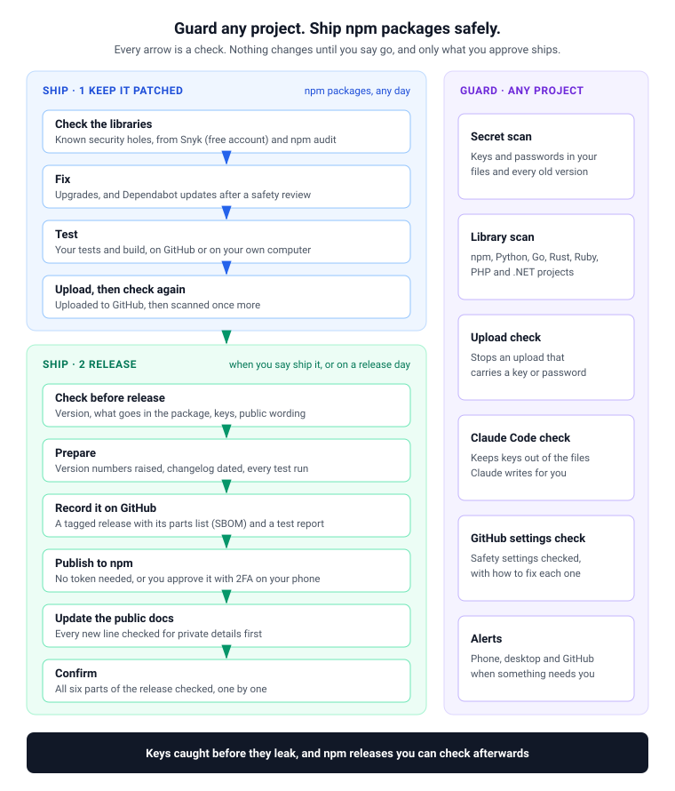

# ShipSecure MCP

[](https://www.npmjs.com/package/shipsecure-mcp) [](LICENSE) [](https://nodejs.org)

**Overview** · [New here?](docs/basics.md) · [Guard](docs/guard.md) · [Ship](docs/ship.md) · [Setup](docs/setup.md) · [Tools](docs/tools.md) · [Security](docs/security.md) · [Privacy](docs/privacy.md) · [Configuration](docs/configuration.md) · [Changelog](CHANGELOG.md)

ShipSecure MCP is a safety helper for your AI coding assistant: Claude Code, ChatGPT (formerly Codex), or any assistant that supports MCP. Once it is set up, you ask your assistant in plain words, and it uses ShipSecure's tools to keep your code safe and to release it.

## What it does for you

- **Finds passwords and keys left in your code.** An API key, token or password in your code can be read by anyone who sees the code. It stays readable even after you delete it, because git keeps every old version. ShipSecure finds them, old versions included, and tells you which ones to replace.
- **Stops new ones from leaking.** Before anything is uploaded to GitHub, it checks for keys and stops the upload if it finds one.
- **Checks the libraries you use.** Most projects are built on other people's code. When one of those libraries has a known security hole, ShipSecure says so and how to fix it. It works with JavaScript, Python, Go, Rust, Ruby, PHP and .NET projects.
- **Releases npm packages safely**, if you publish one. Each release is tested and scanned, and you can audit it afterwards. Nothing private gets published.

**It runs on your computer.** No account, no telemetry, nothing sent to the author: [Privacy](docs/privacy.md) lists exactly what it connects to and why.

New to these words? [New here?](docs/basics.md) explains each one in a sentence.

## What you say to your assistant

| You say | It does |
|---|---|
| "Scan this repo for secrets." | Checks every file and every old version for keys and passwords |
| "Are my dependencies safe?" | Checks the libraries your project uses for known security holes |
| "What does ShipSecure still need?" | Lists what is set up and what is missing |
| "Ship it." | Runs the whole release of an npm package, and shows you a checklist as it goes |

<p align="center">
  
</p>

## Two ways to use it

| | [Guard](docs/guard.md) | [Ship](docs/ship.md) |
|---|---|---|
| **Who it is for** | Anyone with code on GitHub, in any language | People who publish npm packages |
| **Keys and passwords** | Found in your files and every old version, and stopped before upload | The same, plus a check of everything about to be published |
| **Libraries** | Checked for known security holes | The same, and a serious hole stops the release |
| **Releases** | None: Guard never publishes anything | Tested, scanned and verified releases to npm, with a record you can audit |

Start with Guard. Add Ship if you publish npm packages.

## Get started

You need Node.js and the GitHub command-line tool (`gh`). Then, in a terminal:

```bash
npx shipsecure-mcp setup
```

The setup asks you a few questions, signs you in to the services it uses, and connects ShipSecure to your assistant. Every step is explained as you go: [Setup](docs/setup.md).

> **You need a free Snyk account.** Snyk is a service that tracks security holes in libraries. The setup opens its sign-in page, where you can create a free account. If you would rather not, ShipSecure can use OSV.dev, a free public database, instead ([how](docs/setup.md#snyk)).

## License

Apache License 2.0, free to use. See [LICENSE](LICENSE). Questions and bug reports: [issues](https://github.com/rcb0727/shipsecure-mcp/issues).
